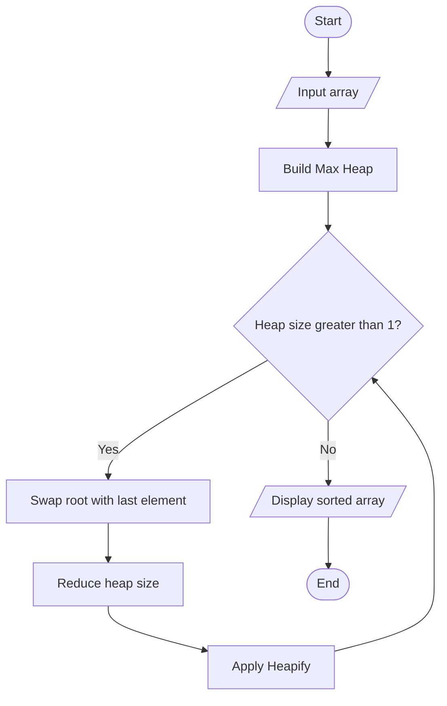

# Heap Sort

## 1. Aim
To implement Heap Sort using a Binary Max Heap and arrange the given elements in ascending order.

## 2. Problem Statement
Given an array of integers, sort its elements in ascending order using the Heap Sort algorithm.

## 3. Algorithm
1. Build a Max Heap from the given array.
2. The root contains the largest element.
3. Swap the root with the last element of the heap.
4. Reduce the heap size by one.
5. Apply heapify to restore the Max Heap property.
6. Repeat until all elements are sorted.

## 4. Pseudocode

```text
HEAP-SORT(A):
    n = length(A)

    for i = n/2 - 1 down to 0:
        HEAPIFY(A, n, i)

    for i = n - 1 down to 1:
        swap A[0] and A[i]
        HEAPIFY(A, i, 0)

HEAPIFY(A, n, root):
    largest = root
    left = 2 * root + 1
    right = 2 * root + 2

    if left < n and A[left] > A[largest]:
        largest = left

    if right < n and A[right] > A[largest]:
        largest = right

    if largest != root:
        swap A[root] and A[largest]
        HEAPIFY(A, n, largest)
```

## 5. Flowchart



## 6. Complexity Analysis

| Case | Time Complexity |
|---|---|
| Best Case | O(n log n) |
| Average Case | O(n log n) |
| Worst Case | O(n log n) |

- Building the Max Heap: O(n)
- Repeated extraction and heapify: O(n log n)
- Auxiliary Space: O(1) for the in-place iterative heap operations; this implementation uses recursive heapify, so its recursion stack can take O(log n) space.

## 7. Sample Input

```text
12 11 13 5 6 7
```

## 8. Sample Output

```text
Original Array: [12, 11, 13, 5, 6, 7]
Sorted Array: [5, 6, 7, 11, 12, 13]
```

## 9. Conclusion
Heap Sort is a comparison-based sorting algorithm that uses a Binary Heap data structure. It provides O(n log n) time complexity in all cases and sorts the array in place.