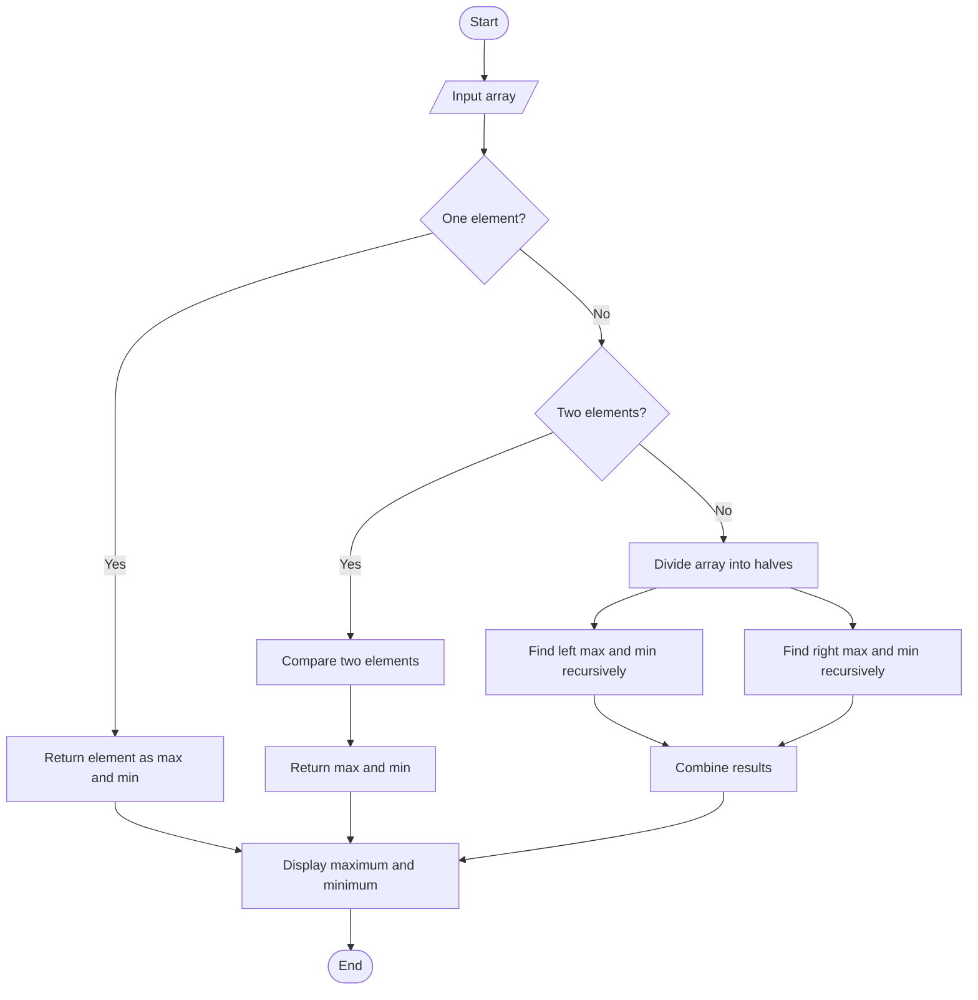

# Maximum and Minimum Using Divide and Conquer

## 1. Problem Statement

Write a program to find the maximum and minimum elements in an array using the Divide and Conquer technique.

## 2. Algorithm / Approach

1. Start.
2. Input the number of elements and array.
3. If the array contains one element, return it as both maximum and minimum.
4. If the array contains two elements, compare them and return the larger and smaller values.
5. Divide the array into two halves.
6. Recursively find maximum and minimum in the left half.
7. Recursively find maximum and minimum in the right half.
8. Compare both results to obtain the overall maximum and minimum.
9. Display the results.
10. Stop.

## 3. Pseudocode

```text
FUNCTION FindMaxMin(arr, low, high)

    IF low == high THEN
        RETURN arr[low], arr[low]
    END IF

    IF high == low + 1 THEN
        IF arr[low] > arr[high] THEN
            RETURN arr[low], arr[high]
        ELSE
            RETURN arr[high], arr[low]
        END IF
    END IF

    mid = (low + high) // 2

    leftMax, leftMin = FindMaxMin(arr, low, mid)

    rightMax, rightMin = FindMaxMin(arr, mid+1, high)

    maximum = MAX(leftMax, rightMax)

    minimum = MIN(leftMin, rightMin)

    RETURN maximum, minimum

END FUNCTION

START

INPUT n
INPUT array

maximum, minimum = FindMaxMin(arr, 0, n-1)

PRINT maximum
PRINT minimum

END
```

## 4. Flowchart



## 5. Time Complexity Analysis

The recurrence relation is:

T(n) = 2T(n/2) + O(1)

| Case | Time Complexity |
|---|---|
| Best Case | O(n) |
| Average Case | O(n) |
| Worst Case | O(n) |

The algorithm performs approximately 3n/2 - 2 comparisons for n being a power of 2.

## 6. Space Complexity

O(log n) auxiliary space due to the recursive call stack.

## 7. Sample Input

```text
Enter number of elements: 6
10
25
5
40
15
30
```

## 8. Sample Output

```text
Maximum element: 40
Minimum element: 5
```

## 9. Learning Outcomes

- Understood the Divide and Conquer technique.
- Implemented recursive maximum and minimum finding.
- Learned array division and result combination.
- Analyzed time and space complexity.
- Practiced recursive problem solving.