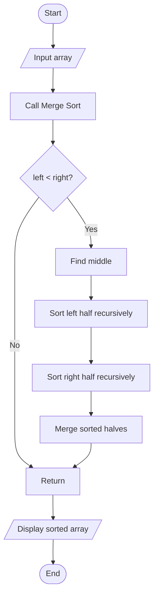

# Merge Sort Using Divide and Conquer

## 1. Problem Statement

Implement Merge Sort using the Divide and Conquer technique to sort an array in ascending order.

## 2. Algorithm / Approach

1. Start.
2. Input the array.
3. Divide the array into two halves.
4. Recursively sort the left half.
5. Recursively sort the right half.
6. Merge both sorted halves into a single sorted array.
7. Display the sorted array.
8. Stop.

## 3. Pseudocode

```text
MERGE_SORT(arr, left, right)

IF left < right THEN

    mid = (left + right) // 2

    MERGE_SORT(arr, left, mid)

    MERGE_SORT(arr, mid+1, right)

    MERGE(arr, left, mid, right)

END IF


MERGE(arr, left, mid, right)

Create left and right temporary arrays

Compare elements of both arrays

Copy smaller element into original array

Copy remaining elements

END MERGE
```

## 4. Flowchart



## 5. Time Complexity Analysis

| Case | Time Complexity |
|---|---|
| Best Case | O(n log n) |
| Average Case | O(n log n) |
| Worst Case | O(n log n) |

## 6. Space Complexity

O(n) auxiliary space for temporary arrays and O(log n) recursive stack space.

Overall auxiliary space: O(n).

## 7. Sample Input

```text
Enter number of elements: 6
38
27
43
3
9
82
```

## 8. Sample Output

```text
Original Array: [38, 27, 43, 3, 9, 82]
Sorted Array: [3, 9, 27, 38, 43, 82]
```

## 9. Learning Outcomes

- Understood Divide and Conquer.
- Implemented Merge Sort.
- Learned recursive division and merging.
- Analyzed time and space complexity.
- Practiced sorting with temporary arrays.