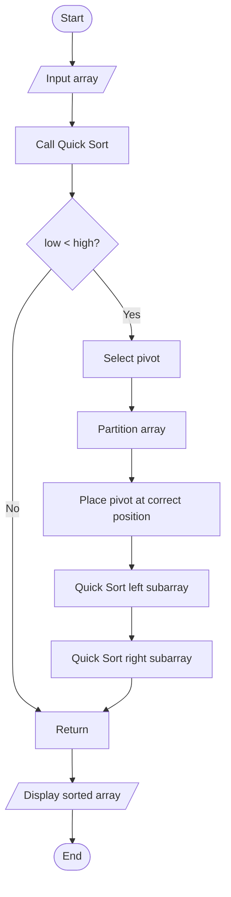

# Quick Sort Using Divide and Conquer

## 1. Problem Statement

Implement Quick Sort using the Divide and Conquer technique to sort an array in ascending order.

## 2. Algorithm / Approach

1. Start.
2. Select the last element as pivot.
3. Partition the array around the pivot.
4. Place smaller or equal elements on the left.
5. Place larger elements on the right.
6. Recursively sort the left subarray.
7. Recursively sort the right subarray.
8. Display the sorted array.
9. Stop.

## 3. Pseudocode

```text
QUICK_SORT(arr, low, high)

IF low < high THEN

    pivot_index = PARTITION(arr, low, high)

    QUICK_SORT(arr, low, pivot_index - 1)

    QUICK_SORT(arr, pivot_index + 1, high)

END IF


PARTITION(arr, low, high)

pivot = arr[high]
i = low - 1

FOR j = low TO high - 1

    IF arr[j] <= pivot THEN
        i = i + 1
        SWAP arr[i] and arr[j]
    END IF

END FOR

SWAP arr[i+1] and arr[high]

RETURN i + 1
```

## 4. Flowchart



## 5. Time Complexity Analysis

| Case | Time Complexity |
|---|---|
| Best Case | O(n log n) |
| Average Case | O(n log n) |
| Worst Case | O(n²) |

## 6. Space Complexity

Average auxiliary recursion stack space: O(log n).

Worst-case auxiliary recursion stack space: O(n).

The partition operation itself uses O(1) auxiliary space.

## 7. Sample Input

```text
Enter number of elements: 6
38
27
43
3
9
82
```

## 8. Sample Output

```text
Original Array: [38, 27, 43, 3, 9, 82]
Sorted Array: [3, 9, 27, 38, 43, 82]
```

## 9. Learning Outcomes

- Understood Divide and Conquer.
- Implemented Quick Sort.
- Learned pivot selection and partitioning.
- Analyzed best, average and worst-case complexity.
- Practiced recursive sorting.