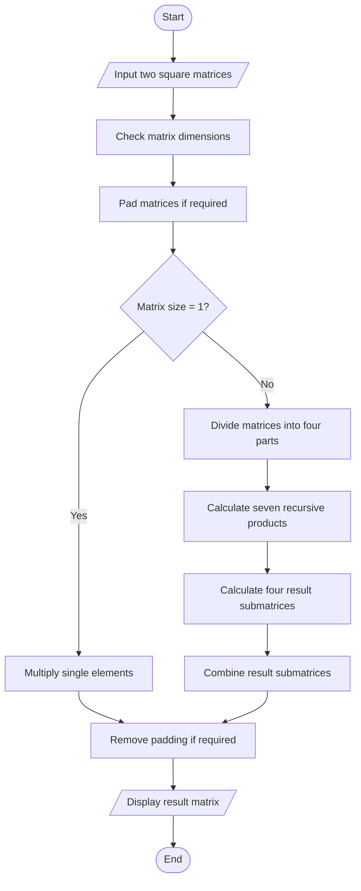

# Strassen Matrix Multiplication

## 1. Aim
To implement Strassen's Matrix Multiplication algorithm using the Divide and Conquer technique.

## 2. Problem Statement
Given two square matrices of order n, multiply them using Strassen's algorithm and display the resultant matrix.

## 3. Algorithm
1. Divide both matrices into four equal submatrices.
2. Calculate seven products using recursive multiplication.
3. Use these seven products to calculate four result submatrices.
4. Combine the four submatrices to obtain the final result.
5. For dimensions that are not powers of 2, pad the matrices with zeros and remove the padding after multiplication.

## 4. Seven Products

Let the four submatrices of A be A11, A12, A21, A22 and those of B be B11, B12, B21, B22.

- M1 = (A11 + A22)(B11 + B22)
- M2 = (A21 + A22)B11
- M3 = A11(B12 - B22)
- M4 = A22(B21 - B11)
- M5 = (A11 + A12)B22
- M6 = (A21 - A11)(B11 + B12)
- M7 = (A12 - A22)(B21 + B22)

Result:

- C11 = M1 + M4 - M5 + M7
- C12 = M3 + M5
- C21 = M2 + M4
- C22 = M1 - M2 + M3 + M6

## 5. Pseudocode

```text
STRASSEN(A, B):
    if matrix size = 1:
        return A[0][0] * B[0][0]

    Divide A into A11, A12, A21, A22
    Divide B into B11, B12, B21, B22

    Calculate M1, M2, M3, M4, M5, M6, M7

    Calculate C11, C12, C21, C22

    Combine C11, C12, C21, C22

    return result
```

## 6. Flowchart



## 7. Complexity Analysis

| Case | Time Complexity |
|---|---|
| Best Case | O(n^2.807) |
| Average Case | O(n^2.807) |
| Worst Case | O(n^2.807) |

- Recurrence: T(n) = 7T(n/2) + O(n²)
- Time Complexity: O(n^log₂7), approximately O(n^2.807).
- The implementation uses additional memory for recursive submatrices and intermediate results.

## 8. Sample Input

```text
Matrix A:
1 2
3 4

Matrix B:
5 6
7 8
```

## 9. Sample Output

```text
19 22
43 50
```

## 10. Conclusion
Strassen's algorithm uses seven recursive matrix multiplications instead of eight. It reduces the asymptotic time complexity compared with conventional matrix multiplication and demonstrates the Divide and Conquer technique.