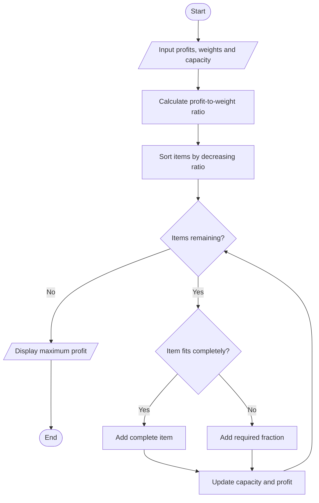

# Fractional Knapsack Using Greedy Method

## 1. Aim

To implement the Fractional Knapsack problem using the Greedy Method.

## 2. Problem Statement

Given a set of items with profits and weights and a knapsack with limited capacity, select items or fractions of items to maximize the total profit.

## 3. Algorithm / Approach

1. Calculate the profit-to-weight ratio for each item.
2. Sort all items in decreasing order of their profit-to-weight ratio.
3. Select items with the highest ratio first.
4. If the complete item fits, add it to the knapsack.
5. If the complete item does not fit, add the required fraction.
6. Continue until the knapsack is full.

## 4. Pseudocode

```text
FRACTIONAL_KNAPSACK(items, capacity)

    Sort items in decreasing order of profit/weight ratio

    totalProfit = 0

    FOR each item

        IF capacity == 0 THEN
            BREAK
        END IF

        IF item.weight <= capacity THEN
            Add complete item
            capacity = capacity - item.weight
            totalProfit = totalProfit + item.profit

        ELSE
            fraction = capacity / item.weight
            totalProfit = totalProfit + item.profit * fraction
            capacity = 0

        END IF

    END FOR

    RETURN totalProfit

END FUNCTION
```

## 5. Flowchart



## 6. Time Complexity

| Operation | Complexity |
|---|---|
| Sorting items | O(n log n) |
| Selecting items | O(n) |
| Overall | O(n log n) |

## 7. Space Complexity

O(n) for storing the items and selected item details.

## 8. Sample Input

```text
Number of items: 3

Profit: 60, Weight: 10
Profit: 100, Weight: 20
Profit: 120, Weight: 30

Capacity: 50
```

## 9. Sample Output

```text
Maximum Profit: 240.00
```

## 10. Learning Outcomes

- Understood the Greedy Method.
- Implemented the Fractional Knapsack problem.
- Used the profit-to-weight ratio for optimal item selection.
- Learned how fractional selection differs from the 0/1 Knapsack problem.