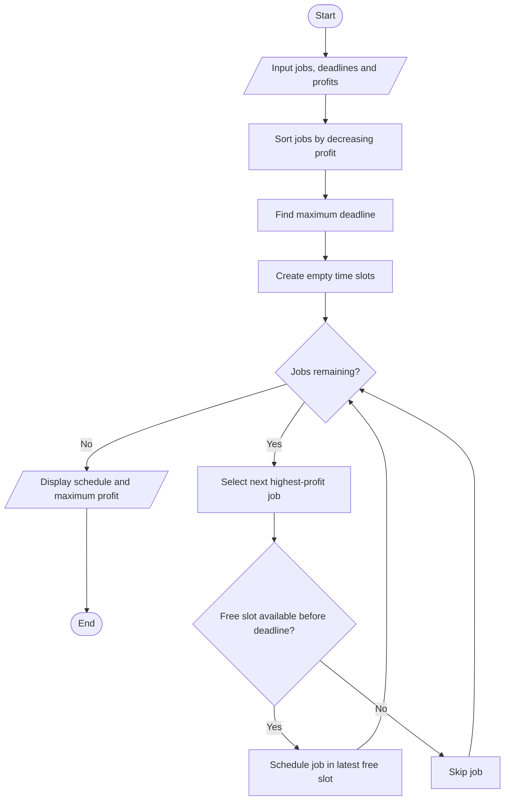

# Job Sequencing with Deadlines Using Greedy Method

## 1. Aim

To implement the Job Sequencing with Deadlines problem using the Greedy Method to maximize total profit.

## 2. Problem Statement

Given a set of jobs where each job has a deadline and profit, schedule the jobs within their deadlines to maximize the total profit. Each job takes one unit of time to complete.

## 3. Algorithm / Approach

1. Sort all jobs in decreasing order of profit.
2. Find the maximum deadline.
3. Create available time slots from 1 to the maximum deadline.
4. Select the job with the highest profit first.
5. Place each job in the latest available slot before its deadline.
6. Continue until all jobs are considered.
7. Display the scheduled jobs and maximum profit.

## 4. Pseudocode

```text
JOB_SEQUENCING(jobs)

    Sort jobs in decreasing order of profit

    maxDeadline = maximum deadline among all jobs

    Create slots from 1 to maxDeadline
    totalProfit = 0

    FOR each job in sorted jobs

        FOR slot = job.deadline DOWNTO 1

            IF slot is empty THEN
                Schedule job in slot
                totalProfit = totalProfit + job.profit
                BREAK
            END IF

        END FOR

    END FOR

    RETURN scheduled jobs and totalProfit

END FUNCTION
```

## 5. Flowchart



## 6. Time Complexity

| Operation | Complexity |
|---|---|
| Sorting jobs | O(n log n) |
| Scheduling jobs | O(n × d) |
| Overall | O(n log n + n × d) |

Where `d` is the maximum deadline.

## 7. Space Complexity

O(d) for storing the available time slots.

## 8. Sample Input

```text
Jobs:
J1 → Deadline: 2, Profit: 100
J2 → Deadline: 1, Profit: 19
J3 → Deadline: 2, Profit: 27
J4 → Deadline: 1, Profit: 25
J5 → Deadline: 3, Profit: 15
```

## 9. Sample Output

```text
Scheduled Jobs:
Slot 1: J3
Slot 2: J1
Slot 3: J5

Maximum Profit: 142.00
```

## 10. Learning Outcomes

- Understood the Greedy Method for scheduling problems.
- Learned how jobs are selected based on profit.
- Implemented deadline-based scheduling.
- Maximized total profit using an efficient greedy approach.