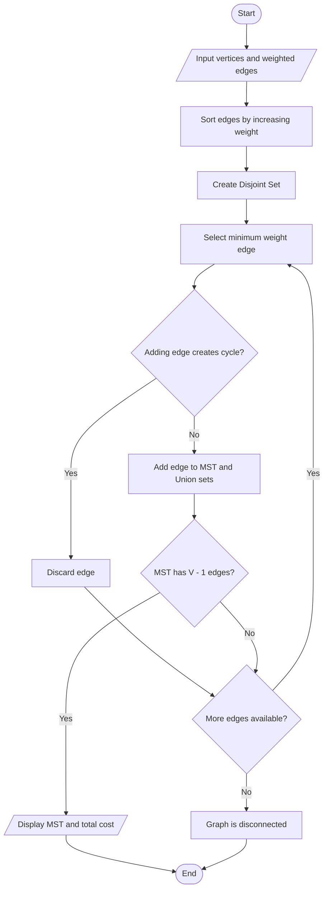

# Kruskal's Algorithm for Minimum Spanning Tree

## 1. Aim

To implement Kruskal's Algorithm using the Greedy Method to find the Minimum Spanning Tree (MST) of a connected weighted graph.

## 2. Problem Statement

Given a connected, weighted, and undirected graph, find a Minimum Spanning Tree that connects all vertices with the minimum possible total edge weight without forming any cycles.

## 3. Algorithm / Approach

1. Sort all edges in increasing order of their weights.
2. Start with an empty Minimum Spanning Tree.
3. Select the edge with the smallest weight.
4. Check whether adding the edge creates a cycle.
5. If no cycle is formed, add the edge to the MST.
6. Use the Disjoint Set (Union-Find) data structure to detect cycles efficiently.
7. Repeat until the MST contains `V - 1` edges.
8. Display the MST and its total cost.

## 4. Pseudocode

```text
KRUSKAL(vertices, edges)

    Sort all edges in increasing order of weight

    Create a Disjoint Set for all vertices

    MST = empty
    totalCost = 0

    FOR each edge (source, destination, weight)

        IF source and destination belong to different sets THEN

            Add edge to MST
            totalCost = totalCost + weight

            Union(source, destination)

        END IF

        IF MST contains vertices - 1 edges THEN
            BREAK
        END IF

    END FOR

    IF MST contains vertices - 1 edges THEN
        RETURN MST and totalCost
    ELSE
        Graph is disconnected
    END IF

END FUNCTION
```

## 5. Flowchart



## 6. Time Complexity

Using edge sorting and the Disjoint Set data structure:

| Operation | Complexity |
|---|---|
| Sorting edges | O(E log E) |
| Union-Find operations | O(E × α(V)) |
| Overall | O(E log E) |

Where:

- `V` = number of vertices
- `E` = number of edges
- `α(V)` is the inverse Ackermann function, which is nearly constant.

## 7. Space Complexity

O(V + E) for storing the edges, Disjoint Set data structure, and MST.

## 8. Sample Input

```text
Vertices: 5
Edges: 7

0 1 2
0 3 6
1 2 3
1 3 8
1 4 5
2 4 7
3 4 9
```

## 9. Sample Output

```text
Edges in the Minimum Spanning Tree:
0 -- 1 (Weight: 2)
1 -- 2 (Weight: 3)
1 -- 4 (Weight: 5)
0 -- 3 (Weight: 6

Total Cost of MST: 16
```

## 10. Learning Outcomes

- Understood the Greedy Method for finding a Minimum Spanning Tree.
- Implemented Kruskal's Algorithm.
- Used the Disjoint Set (Union-Find) data structure.
- Learned how cycle detection is used while constructing an MST.
- Compared edge-based MST construction with other approaches.