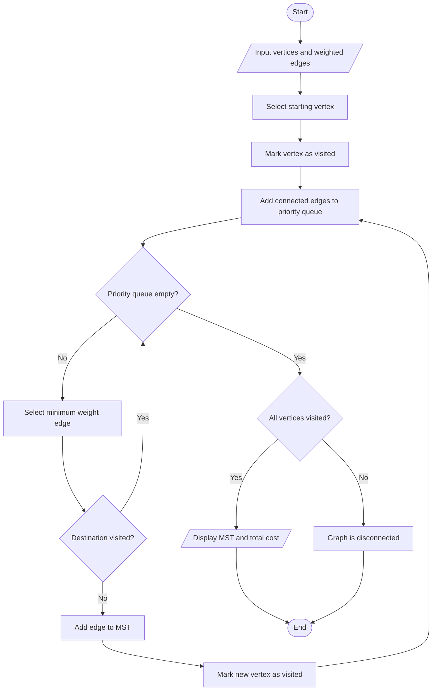

# Prim's Algorithm for Minimum Spanning Tree

## 1. Aim

To implement Prim's Algorithm using the Greedy Method to find the Minimum Spanning Tree (MST) of a connected weighted graph.

## 2. Problem Statement

Given a connected, weighted, and undirected graph, find a Minimum Spanning Tree that connects all vertices with the minimum possible total edge weight.

## 3. Algorithm / Approach

1. Start with any vertex.
2. Mark the starting vertex as visited.
3. Add all edges connected to the visited vertices to a priority queue.
4. Select the edge with the minimum weight.
5. If the selected edge connects to an unvisited vertex, add it to the MST.
6. Repeat until all vertices are included in the MST.
7. Display the edges and total cost of the MST.

## 4. Pseudocode

```text
PRIMS(graph, vertices)

    Mark all vertices as unvisited

    Select a starting vertex

    Add starting vertex to priority queue

    WHILE priority queue is not empty

        Remove edge with minimum weight

        IF current vertex is already visited THEN
            CONTINUE
        END IF

        Mark current vertex as visited

        IF edge has a parent THEN
            Add edge to MST
            Add weight to total cost
        END IF

        FOR each neighbor of current vertex

            IF neighbor is not visited THEN
                Add edge to priority queue
            END IF

        END FOR

    END WHILE

    IF all vertices are visited THEN
        RETURN MST and total cost
    ELSE
        Graph is disconnected
    END IF

END FUNCTION
```

## 5. Flowchart



## 6. Time Complexity

Using a Min-Heap priority queue:

| Operation | Complexity |
|---|---|
| Priority Queue Operations | O(log V) |
| Overall | O(E log V) |

Where:

- `V` = number of vertices
- `E` = number of edges

## 7. Space Complexity

O(V + E) for the graph representation, visited array, priority queue, and MST storage.

## 8. Sample Input

```text
Vertices: 5
Edges: 7

0 1 2
0 3 6
1 2 3
1 3 8
1 4 5
2 4 7
3 4 9
```

## 9. Sample Output

```text
Edges in the Minimum Spanning Tree:
0 -- 1 (Weight: 2)
1 -- 2 (Weight: 3)
1 -- 4 (Weight: 5)
0 -- 3 (Weight: 6)

Total Cost of MST: 16
```

## 10. Learning Outcomes

- Understood the concept of Minimum Spanning Trees.
- Implemented Prim's Algorithm using the Greedy Method.
- Used a priority queue to select minimum-weight edges efficiently.
- Calculated the minimum total cost required to connect all vertices.