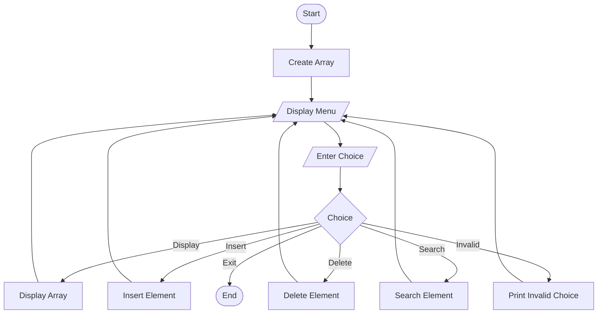

# Unit 1 - Algorithm Flowcharts

## 1. Iterative Binary Search

```mermaid
flowchart TD
    A([Start]) --> B[/Input sorted array and target/]
    B --> C[low = 0, high = n-1]
    C --> D{low <= high?}
    D -- No --> E[/Print Element Not Found/]
    E --> Z([End])
    D -- Yes --> F[mid = low + high // 2]
    F --> G{arr[mid] == target?}
    G -- Yes --> H[/Print Found Index/]
    H --> Z
    G -- No --> I{arr[mid] < target?}
    I -- Yes --> J[low = mid + 1]
    I -- No --> K[high = mid - 1]
    J --> D
    K --> D
```

## 2. Recursive Binary Search

```mermaid
flowchart TD
    A([Start]) --> B[/Input array and target/]
    B --> C[Call Binary Search]
    C --> D{low > high?}
    D -- Yes --> E[Return -1]
    D -- No --> F[Calculate mid]
    F --> G{arr[mid] == target?}
    G -- Yes --> H[Return mid]
    G -- No --> I{arr[mid] < target?}
    I -- Yes --> J[Search right half recursively]
    I -- No --> K[Search left half recursively]
    J --> L[Return result]
    K --> L
    E --> M([End])
    H --> M
    L --> M
```

## 3. Basic Array Operations


