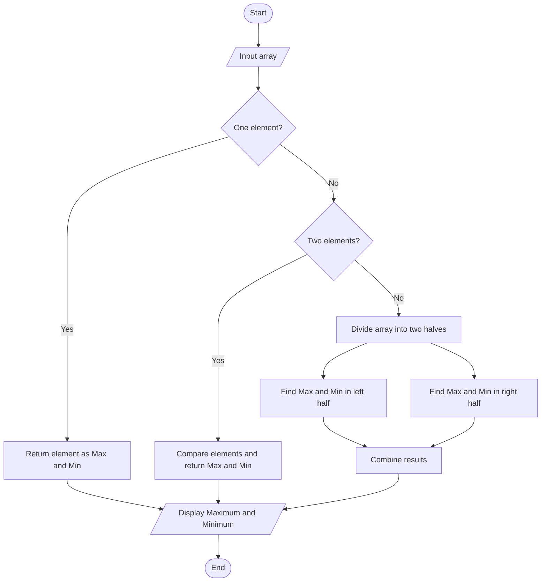
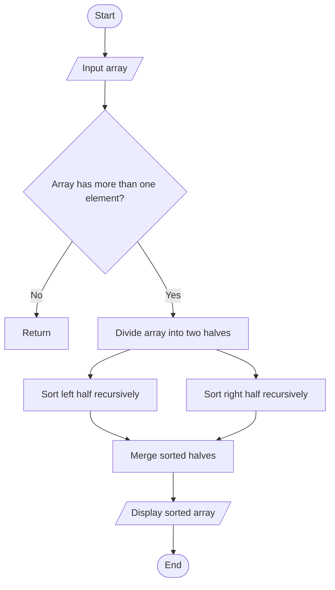
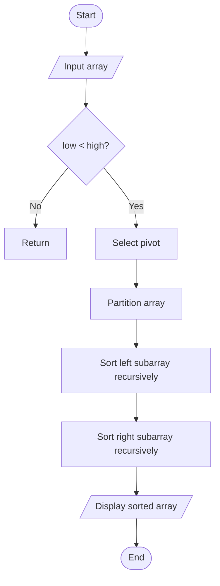
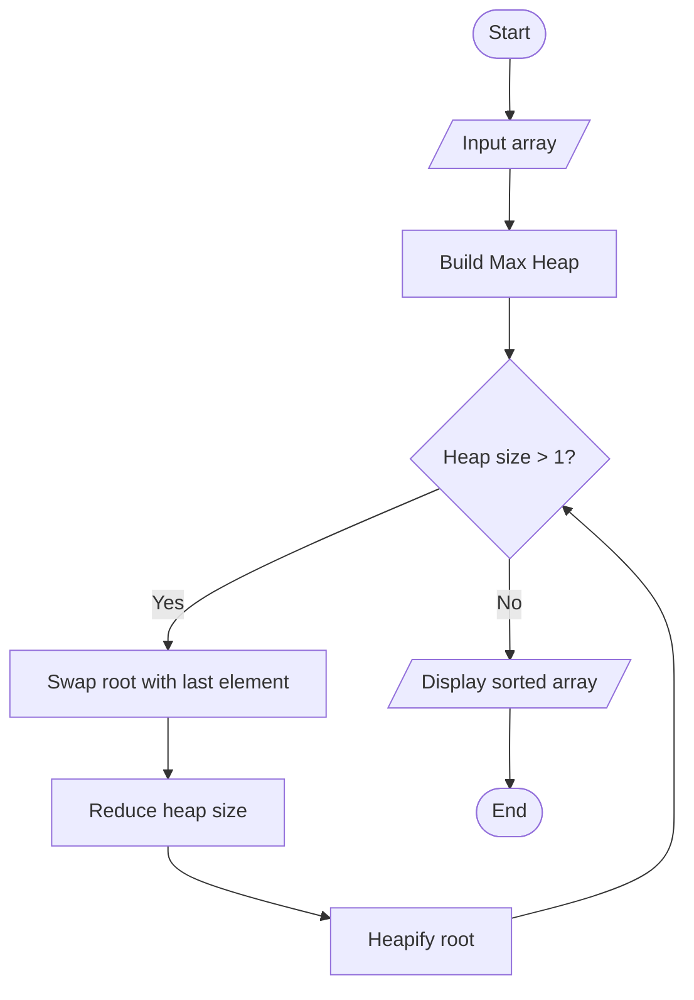
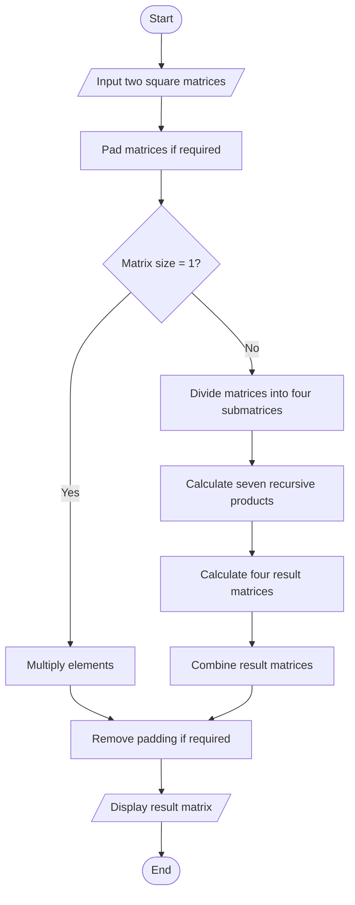

# Unit 2 - Divide and Conquer: Algorithm Flowcharts

## 1. Binary Search

```mermaid
flowchart TD
    A([Start]) --> B[/Input sorted array and target/]
    B --> C[Set low = 0 and high = n - 1]
    C --> D{low <= high?}
    D -- No --> E[Return -1]
    D -- Yes --> F[Calculate mid]
    F --> G{arr[mid] equals target?}
    G -- Yes --> H[Return mid]
    G -- No --> I{arr[mid] < target?}
    I -- Yes --> J[Search right half recursively]
    I -- No --> K[Search left half recursively]
    J --> D
    K --> D
```

## 2. Maximum and Minimum



## 3. Merge Sort



## 4. Quick Sort



## 5. Heap Sort



## 6. Strassen Matrix Multiplication

