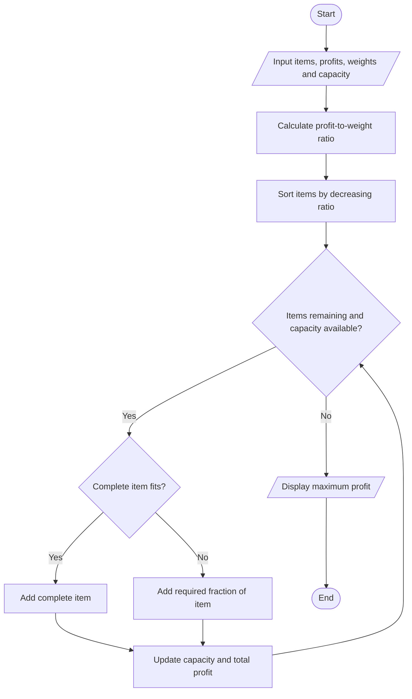
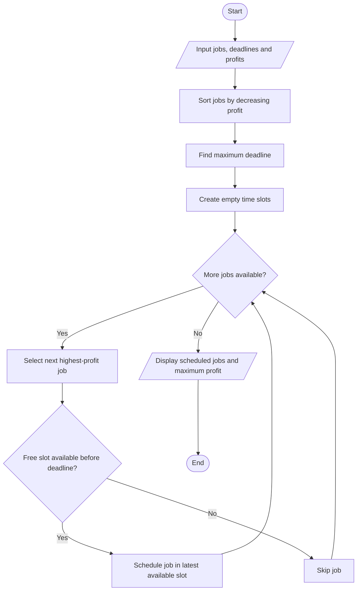
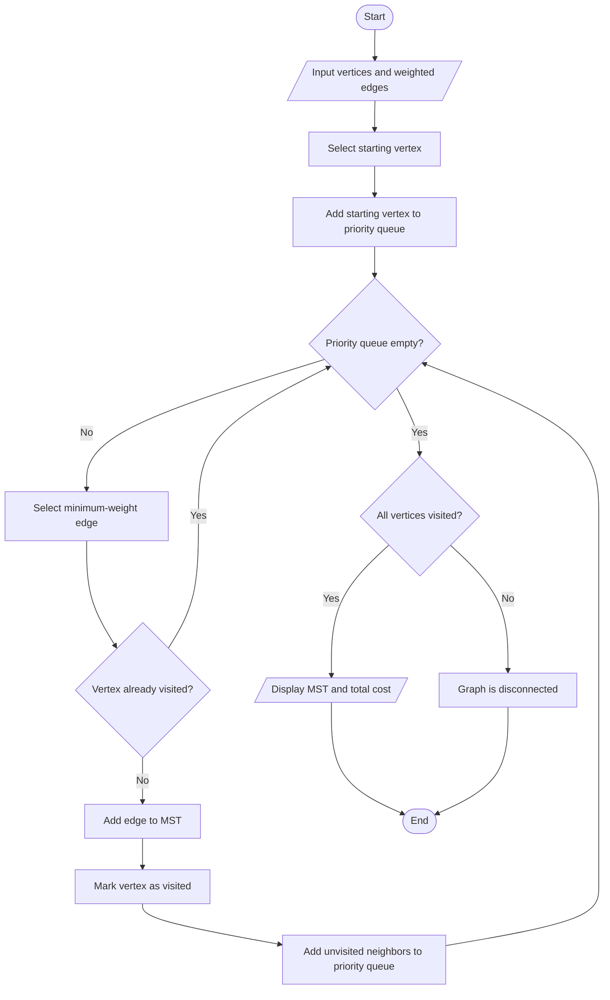
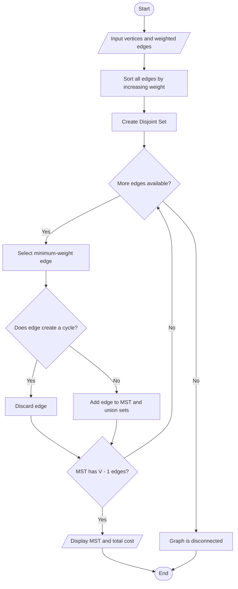

# Unit 3 - Greedy Method: Algorithm Flowcharts

## 1. Fractional Knapsack

---

## 2. Job Sequencing with Deadlines

---

## 3. Prim's Algorithm

---

## 4. Kruskal's Algorithm

---

## Conclusion

These flowcharts represent the working process of all algorithms implemented in Unit 3 using the Greedy Method.