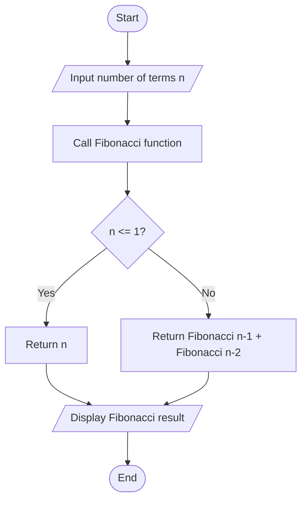
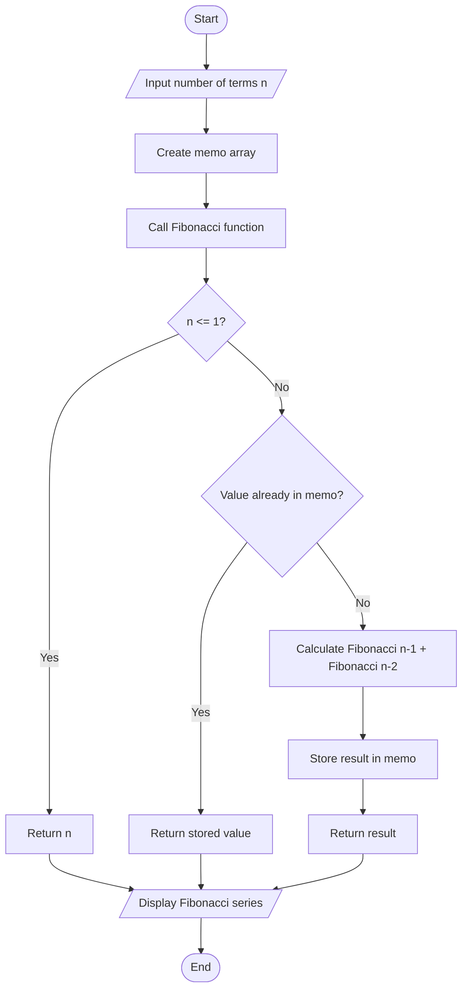
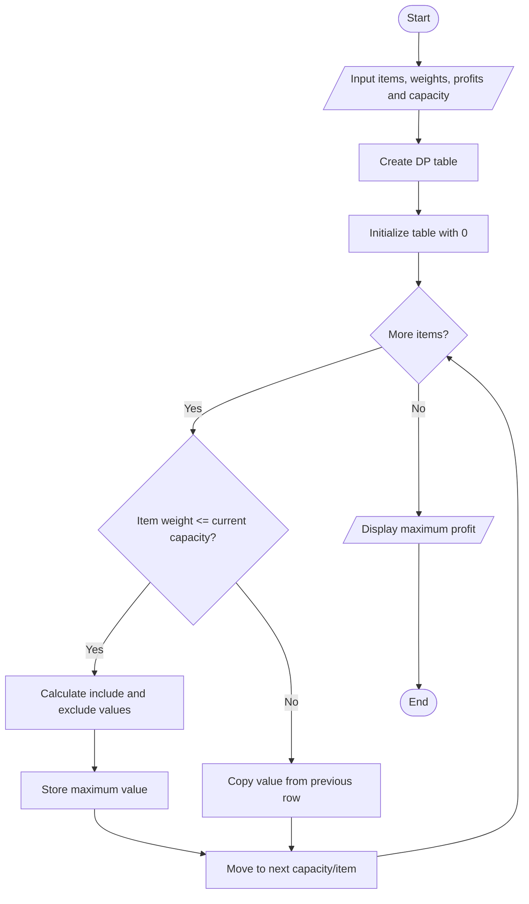
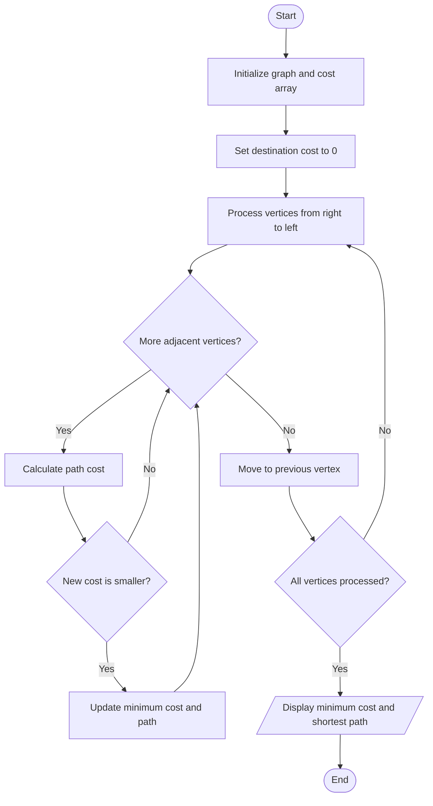
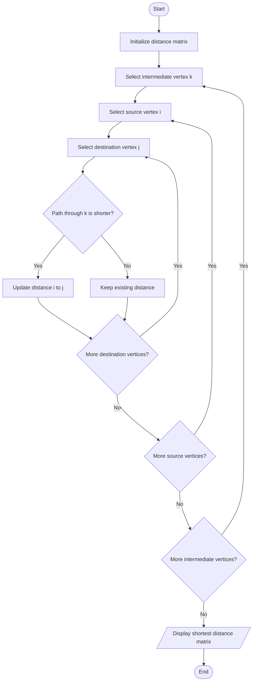
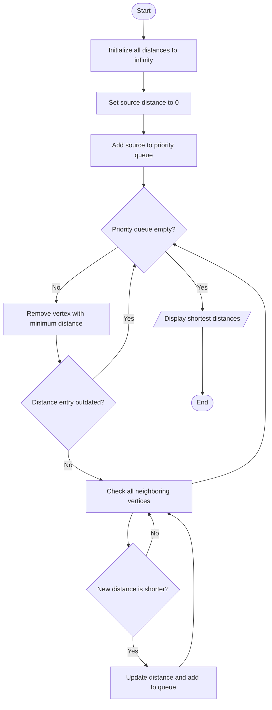
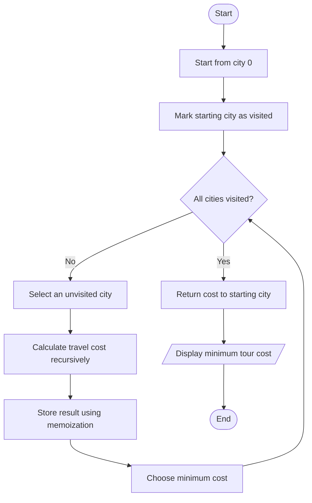

# Unit 4 - Dynamic Programming: Algorithm Flowcharts

## 1. Fibonacci Using Recursion

---

## 2. Fibonacci Using Memoization

---

## 3. 0/1 Knapsack

---

## 4. Multistage Graph

---

## 5. Floyd-Warshall Algorithm

---

## 6. Single-Source Shortest Path (Dijkstra's Algorithm)

---

## 7. Traveling Salesperson Problem

---

## Conclusion

These flowcharts represent the working process of all algorithms implemented in Unit 4 using Dynamic Programming.