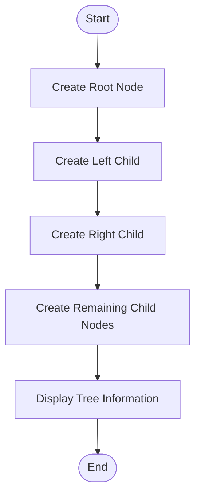
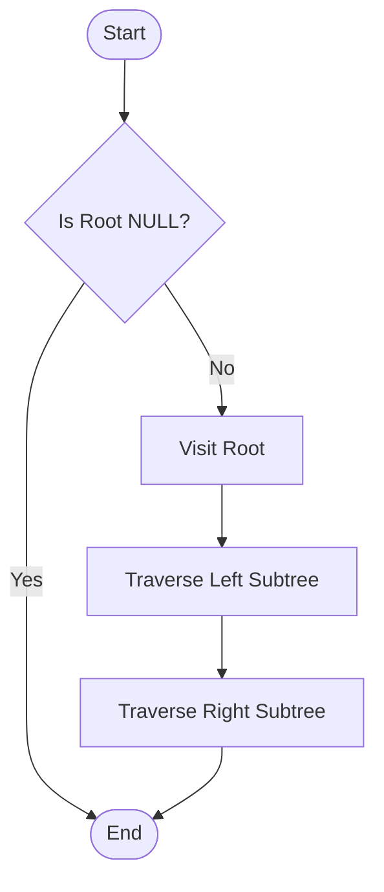
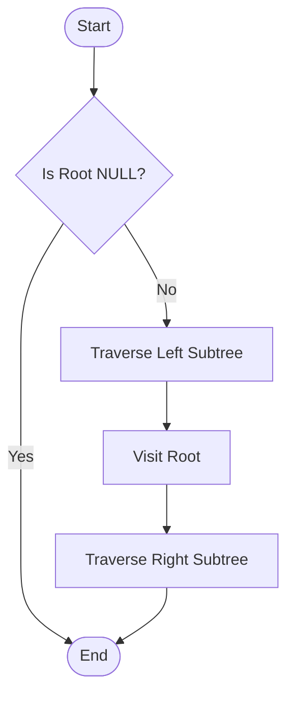
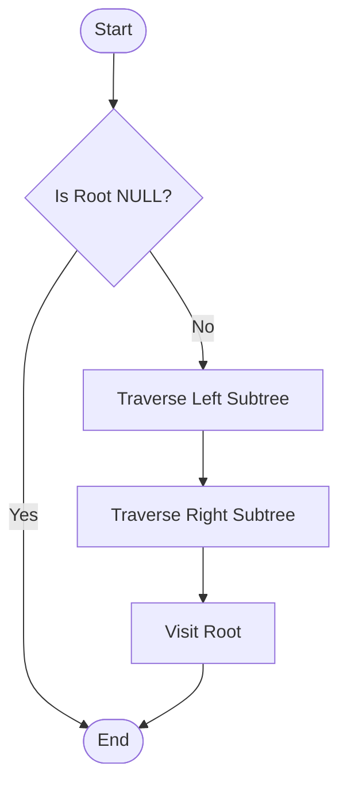
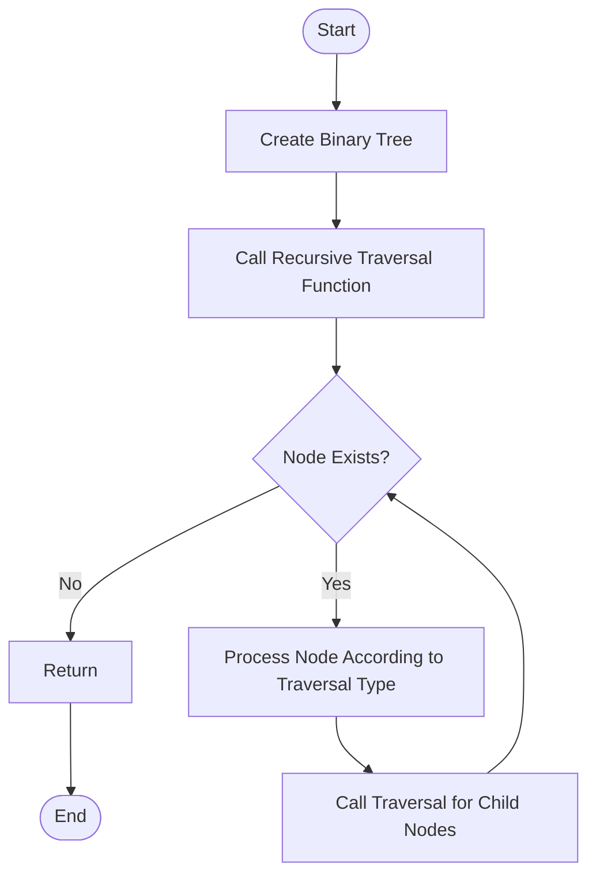
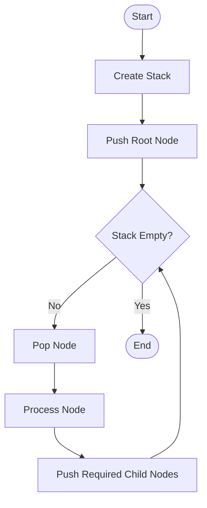
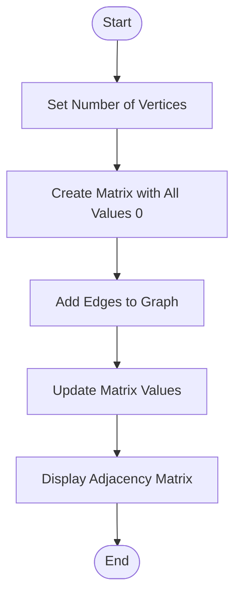

# Unit 05 - Basic Traversal and Search: Algorithm Flowcharts

## 1. Binary Tree Creation

---

## 2. Preorder Traversal

**Order: Root → Left → Right**

---

## 3. Inorder Traversal

**Order: Left → Root → Right**

---

## 4. Postorder Traversal

**Order: Left → Right → Root**

---

## 5. Recursive Tree Traversal

---

## 6. Iterative Tree Traversal

---

## 7. Graph Using Adjacency Matrix

---

# Conclusion

These flowcharts represent the tree creation, traversal, and graph representation algorithms implemented in Unit 05.